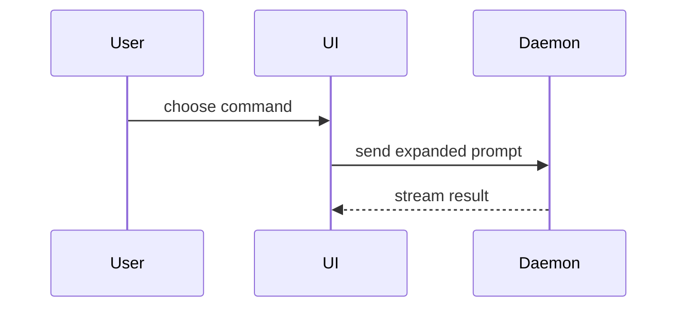
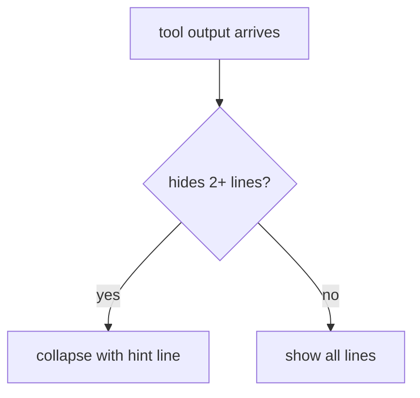

# 写 PR 描述

为当前分支创建或更新 PR。目标是 reviewer 只读描述，就能从逻辑和架构上理解这个改动：为什么存在、核心思路是什么、改完后系统长什么样、现有用户会失去什么，以及该从哪里开始看代码。

## 工作流

1. 读 PR 模板：

   `Read(.github/pull_request_template.md)`

2. 找到或创建 PR：
   - 先查当前分支有没有 PR：`gh pr view --json url,number,title,state 2>/dev/null`。
   - 没有的话，看 `git status --short --branch` 和当前分支上的提交。
   - 提交剩余改动，带 upstream 推送分支，用 `gh pr create` 创建 PR。
   - 遵守仓库的 git 安全规范。

3. 收集解释改动所需的上下文：
   - 读关联的 issue 和相关任务产物。
   - 读完整 diff（`git diff main...HEAD`）和足够的周边代码，理解行为与归属。
   - PR 已存在时，用 `gh pr view` 拿元数据和改动文件列表。
   - 改动让用户看到的界面或输出变了的，准备视觉证据，见"UI/UX 变化的视觉证据"。

4. 按模板各节写描述。描述用用户当前使用的语言，行为变化表也一样；只有三样固定：PR 标题保持英文 Conventional Commit，changeset 保持英文（见 `gen-changesets` skill），节标题沿用模板原文。
   - **Requirement or Bug**：两三句话讲清谁遇到了什么问题、这个 PR 之后能做到什么；有 issue 的写 `Resolve #<number>`，再补一句背景。解决办法留给 Code Changes。
   - **Bug Reproduction Steps**：只有 bug 类 PR 需要；feature 写 `N/A`。步骤已在 issue 里的写 `See linked issue`。
   - **Root Cause**：只有 bug 类 PR 需要；feature 写 `N/A`。说明根因，以及这是根本修复还是绕过。机制要靠时序或状态才说得清的，用图，见"代码变更的可视化大纲"。
   - **Code Changes**：先判断要不要先建立整体理解，再讲具体变化，见"讲清楚改动"。
   - **Screenshots / Recordings**：模板里没有这一节。有可见的 UI/UX 变化时加在 Code Changes 后面，没有就不加，见"UI/UX 变化的视觉证据"。
   - **Behavior Changes and Affected Users**：先填行为变化表，再列受影响模块与测试覆盖，见"行为变化与受影响人群"。验证只写结论：覆盖了哪些场景、哪些没验证；测试文件清单、全量运行结果和修复过程放进折叠块。
   - **Checklist**：勾上所有适用的项。

5. 发布描述：
   - 描述里有图片的，先按"UI/UX 变化的视觉证据"上传，换成真实链接。
   - 先存到临时文件，再 `gh pr edit <number> --body-file <path>` 或 `gh pr create --body-file <path>`。
   - 确认更新成功。

## 行为变化与受影响人群

这一节回答一个问题：合入之后，现有用户会失去什么。这个仓库过去的回归大多来自没人回答这个问题，而不是逻辑错误。

判据：**改动前能工作的任何输入（配置键、环境变量、命令行参数、provider 响应形态、旧版本写的会话数据、客户端请求、hook 载荷）改动后必须行为不变，除非这里明确声明了变化并给出退路。**

写法：

1. 列出 diff 改变的每一个可观测行为，一行一个。包括你认为"不变"但分支条件挪动了的：新增的条件会不会先于旧条件命中既有输入；删除或收窄的分支改动前谁在走。内部包会打进 CLI 发布包，"内部"不等于用户无感。表格用 PR 描述的语言，下面的示例用英文只是示意形状：

   | Behavior | Before | After | Who relies on the old behavior | Escape hatch |
   |---|---|---|---|---|
   | reasoning parsing when `reasoning_details` is an array | string `reasoning` also read | string ignored | OpenAI-compatible gateways that send both (OpenRouter dialect) | none |

2. 人群要具名，不要写"部分用户"。从 `.agents/skills/review-pr/surfaces.md` 里取：客户端（TUI、print 模式、desktop 与 web、VS Code、ACP、SDK）、provider 方言、平台、配置状态、数据年代、外部脚本。

3. 改了 prompt 文本（system prompt、工具描述、提醒）的，每一句单独成行，写清这句改动前约束了什么行为、谁依赖、现在由什么来约束。"没有测试引用这句"不是无影响的证据。

4. 替换或绕过旧路径的（移植、runtime binding、协议替换），额外列出旧路径的功能清单：它认哪些环境变量、有哪些兜底、接受哪些输入，以及每一项在新路径里的位置。

5. 确实没有可观测变化的，写 `None`，并说明证据：哪些分支、默认值、契约文件没动。

6. 表后面列受影响模块与每一行对应的测试覆盖。默认翻转或删除行为的，必须有一条测试把未被改动的人群的旧行为钉住，并且 changeset 要写明用户失去了什么，见 `gen-changesets` skill；没有退路的，在 PR 里请维护者显式拍板。

## 讲清楚改动

Code Changes 要让 reviewer 不看 diff 也能从逻辑和架构上理解这个 PR。先判断要不要先建立整体理解：

- 需要：改动跨多个模块，引入新概念、新数据流或新的部署形态，替换旧路径，或者 diff 大到 reviewer 不知道从哪看起。
- 不需要：在已有结构里改一个点，比如修一个判断条件。直接用"代码变更的可视化大纲"讲变化。
- 拿不准时问自己：reviewer 不先知道改完后系统长什么样，能看懂具体变化吗？

需要时按下面的顺序写，没有内容的部分省略：

1. **核心思路**：开头一段话，说清用什么办法解决问题、系统的关键变化是什么、对现有用户意味着什么。标准是只读这一段就能复述这个 PR。
2. **概念**：引入或改变了概念时先定义，一行一个：`概念 | 回答什么问题 | 本 PR 之后`。
3. **结构图**：用 Mermaid 画改完后系统长什么样：模块、职责、数据流或部署拓扑。节点是模块和职责，不是函数名。图后用一两句话讲清为什么这样组织。
4. **关键决策**：`决策 | 选择 | 没选 | 理由`。只列 reviewer 可能会问"为什么不……"的决策。理由要来自作者的真实考虑；对话和 issue 里没提过、只是你从代码推断出来的理由，先和用户确认再写。
5. **走一遍**：挑一个典型场景，用 `sequenceDiagram` 沿新路径讲一遍。结构图已经讲清流程时省略。
6. **阅读指南**：按阅读顺序列出核心文件，每个附一句"看它能明白什么"；再用一句话列出可以略读的部分，比如参数透传、接线、重命名、整体删除、测试和文档。

之后再用可视化大纲讲具体变化。有了阅读指南，文件树 diff 通常可以省掉。

不论 PR 大小都遵守：
- 图表摆事实，句子讲因果。每张图或表后面跟一两句完整的话，说清"因为、所以、而不是"；不要把名词短语和函数名堆成一行。
- 新术语第一次出现就解释。
- 正文只留理解所需的内容。次要的子流程、长清单、验证过程放进 `<details><summary>标题</summary>…</details>` 折叠块；`</summary>` 后空一行，里面的 Markdown 才会渲染。

## 代码变更的可视化大纲

讲具体变化时用结构化视图，并配一两句话说明因果。用能说清实现的最小组合，没变的类别不要列。

逻辑或算法变化用伪代码 diff：

```diff
 on(save)
-  write content
+  if content is unchanged
+    return cached result
+  write new content
+  invalidate cache
```

运行时控制流用调用树 diff：

```diff
 submitForm
   createSession
     persistPrompt
+    expandSkillMention
     launchAgent
-  navigateToSession
+  navigateToSession
+    subscribeToEvents
```

文件职责变化用浅层文件树 diff：

```diff
 src/
 ├── commands/
+│   └── show-me.ts       # expands the slash command
 ├── sessions/
-└── transport.ts
+└── transport/
+    ├── client.ts
+    └── stream.ts
```

组件或 UI 结构变化用树 diff：

```diff
 <SessionPage>
   useSessionEvents()
   <SessionToolbar>
+    <RunSkillButton />
   <SessionTimeline>
+    <SkillResultCard />
```

组件之间的交互和时序用 Mermaid `sequenceDiagram`，解释 bug 机制时尤其有用：



分支判断用 `flowchart`，状态迁移用 `stateDiagram-v2`：



关键数据结构或类型变化用对应语言的代码块：

```ts
interface SessionEvents {
  onTurnStart(cb: (turn: Turn) => void): void;
  onTurnEnd(cb: (turn: Turn) => void): void;
}
```

可视化大纲的规则：
- 重点是"变了什么"且周边形状已存在时，用 `diff` 块。
- 大部分是新内容，或 diff 记法会掩盖归属和顺序时，用对应语言或 `text` 块给出完整目标形状。
- 按最容易理解的顺序讲：先文件还是先数据结构，哪个合适用哪个。
- 图是为了省 reviewer 的时间：一两句话能说清的不画；一张图只讲一件事，节点多到要来回找时拆成几张。
- 像一个人对另一个人讲话：简单、连贯、简洁。

## UI/UX 变化的视觉证据

用户看到的东西变了，就让 reviewer 直接看到改动前后的样子，不要只用文字描述。涉及范围：TUI（`apps/kimi-code/src/tui`、`packages/pi-tui`）、`apps/vis/web`、`apps/vscode/webview-ui`、`dist-web` 同步，以及用户可见的文本输出（print 模式输出、报错文案、命令行帮助）。

选能说清变化的最低成本形式：

| 形式 | 适用 | 怎么得到 |
|---|---|---|
| 终端文本快照（`text` 代码块） | TUI 的布局、文案、对齐、折叠截断 | 用 `packages/pi-tui/test/virtual-terminal.ts` 渲染，或真实运行后复制屏幕内容 |
| 截图 | 颜色、主题、web 和 webview 界面 | 真实运行后截屏 |
| GIF | 只用于交互和时序：按键、展开折叠、流式输出、动画 | 本机有录屏工具就录；没有就退回关键帧截图或文本快照，不为此装工具 |

写法：
- 加在 Code Changes 后面，节标题 `## Screenshots / Recordings`。
- 改动前后用两列表格并排；全新的界面只放改动后。每组图前用一句话说明该看哪里。
- 证据来自 PR 分支的真实运行或测试渲染，不要手画示意图冒充。文本快照保持原样，不手工调整对齐。
- GIF 只录能说明问题的几秒，体积控制在几 MB 内。
- 素材先放在 `.tmp/pr-media/`，不提交进 PR 分支。

上传：`gh` 不能把图片传成 GitHub 附件，所以把素材推到 origin 上专门放图的孤立分支 `pr-assets/<number>`。在仓库根目录执行：

```bash
url=$(git remote get-url origin)
dir=$(mktemp -d) && cp .tmp/pr-media/<files> "$dir"/ && cd "$dir" && git init -q
git fetch -q "$url" pr-assets/<number> 2>/dev/null && git reset -q --soft FETCH_HEAD  # 分支已存在就接在后面
git add -A && git commit -qm "chore: add screenshots for #<number>"
git push -q "$url" HEAD:refs/heads/pr-assets/<number>
git rev-parse HEAD  # 链接里的 <sha>
```

引用写成 ``。

- 链接用 `<sha>`，不要用分支名：追加的提交只含新文件，按分支名引用会让旧图失效。
- 只推 `pr-assets/` 分支，不建 release。CI 只在 `main` 和 `release/*` 的 push 上触发，这类分支不会跑 CI。
- 不要 force push，合入后也不要删这个分支，否则引用的提交不可达，图会失效。
- 本仓库公开，上传等于公开发布。上传前逐张看一遍：用中性的工作区和示例数据截图，画面里不能出现本机用户名路径、API key、真实会话内容，以及内部域名、未发布的模型名这类内部标识。
- 会话里有人类协作时，推送前列出要上传的文件，等对方确认。
