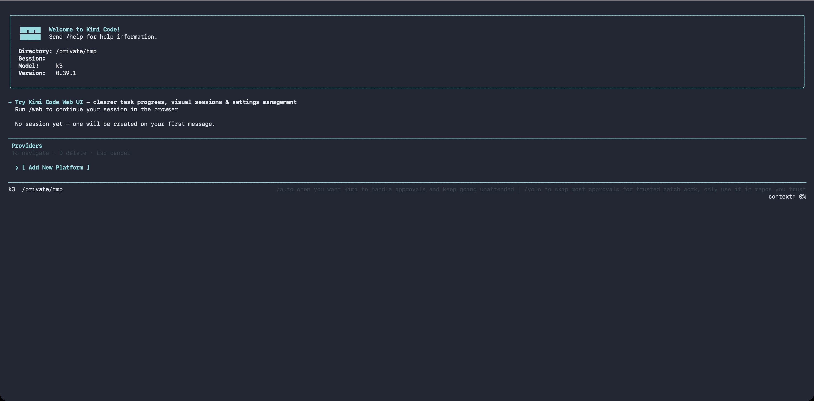

# Providers and models

Kimi Code CLI supports connecting to multiple LLM platforms simultaneously: one-click login via the Kimi Code managed service, connecting Claude with an Anthropic API key, or connecting third-party inference services via the OpenAI-compatible protocol. Each provider corresponds to a specific API protocol; models are declared on top of providers with their own name, context length, and capabilities. This page explains how to configure each type of provider in `config.toml`.

## Supported provider types

The `type` field in the `providers` table determines which protocol implementation to use:

| Type | Protocol | Typical use |
| --- | --- | --- |
| [`kimi`](#kimi) | OpenAI-compatible | Kimi Code managed service, Kimi Platform API key |
| [`anthropic`](#anthropic) | Anthropic Messages | Claude model family |
| [`openai`](#openai) | OpenAI Chat Completions | OpenAI and compatible services, DeepSeek, Qwen, etc. |
| [`openai_responses`](#openai_responses) | OpenAI Responses API | OpenAI's newer Responses interface |
| [`bedrock`](#bedrock) | Anthropic Messages / OpenAI-compatible (per model) | Amazon Bedrock |
| [`google-genai`](#google-genai) | Google GenAI | Gemini API |
| [`vertexai`](#vertexai) | Google GenAI on Vertex | Google Cloud Vertex AI |

All providers communicate with models in streaming mode by default. Capabilities such as thinking, vision, and tool use are matched automatically by model name prefix, so you typically do not need to declare them manually.

**Credential priority**: `api_key` or `api_key_env` (mutually exclusive alternatives — set exactly one) > `[providers.<name>.env]` sub-table key (only when neither is present) > if all are absent, startup fails with an error. Except for the explicitly declared `api_key_env`, the CLI does not fall back to shell environment variables for credentials. See [Config overrides: provider credentials](./overrides.md#provider-credentials).

## `/provider` — interactive provider management

Prefer not to edit TOML by hand? Type `/provider` in the TUI to open the **provider manager**, where you can interactively add or remove providers.



The manager displays providers as a list of entries grouped by source. Navigation:

- ↑/↓ to move the cursor, ←/→ to page
- `d` to delete the current provider (with `[y/N]` confirmation)
- Press Enter on the `[ Add New Platform ]` row to add a new provider

Two paths when adding:

- **Known third-party provider**: fetches the model catalog from [models.dev](https://models.dev/), select a provider → enter an API key → select a default model. Vendors whose protocol the catalog does not declare (e.g. xai, openrouter, and other vendor-specific SDKs) are imported as OpenAI-compatible with a "guessed" note; when the catalog provides no usable endpoint, a base URL prompt appears first; proprietary protocols (Amazon Bedrock, Cohere) and unrecognized explicit protocols are refused. Deprecated and alpha-status models are excluded from the import list. If the public catalog is unreachable, the CLI falls back to a built-in snapshot of the catalog, so the import still works offline or in blocked networks
- **Custom registry (api.json)**: paste a custom registry URL and, for private registries, a Bearer token; the CLI automatically creates the `providers` / `models` entries. When a registry entry declares the `env` field (the name of the environment variable holding the API key), the CLI prints it as a hint — set `api_key_env` in `config.toml` yourself to use it. The binding is never automatic: the registry chooses both the variable name and the endpoint the credential is sent to, so it must not decide which of your secrets is read. For private registries the Bearer token itself is still stored as `source.apiKey` so the registry can be refetched on refresh. On later startup, providers from the same registry URL are refreshed together, so upstream provider additions, removals, and model metadata changes are synced.

  A registry model may also declare an `upgrade` object. `model` selects the replacement model in the same provider, `migration_markdown` supplies the explanation shown during migration (`{model_from}` and `{model_to}` in it are replaced with the model ids on import), and `retirement_at` is an optional RFC3339 timestamp or `null`. The field is stored on the corresponding model alias and returned by `GET /api/v1/models`, so clients can recover migration guidance whenever they reload the catalog. Refreshing syncs or removes this metadata and leaves the default model alone while the registry still lists it. When the registry drops the default model, the default moves to the `upgrade` target that model declared if the target still exists, keeping your thinking setting; otherwise the default and the thinking setting are cleared. Open sessions still using the dropped model switch to that target too, keeping their thinking level when the target supports it. To retire a model, declare `upgrade` on it first and keep it listed long enough for clients to refresh at least once, then remove it from the registry.

  On startup, the TUI prompts when the current model has a valid upgrade target, including after choosing a session to resume. The explanation is rendered as Markdown. The prompt waits until the editor is empty and no turn or dialog is active; if an approval or question interrupts it, it returns when the editor is idle again. Confirm with `Enter`; `Space` does not accept a migration. Accepting switches the model and keeps the current effort when the previous model supports thinking and the target supports that effort, otherwise the target's default effort is used; keeping the current model records the choice so that migration is not shown again. When the startup refresh finds that the registry dropped the default model, the TUI shows a warning and, if the current session uses that model, switches it to the replacement with the same effort rule, without asking.

  Besides the automatic startup refresh, you can trigger the same refresh manually at runtime: `/provider refresh` re-fetches the model list of every provider, and `/provider refresh <providerId>` limits the refresh to a single provider. The command reports added and removed models per provider; a removed alias stops resolving for agents bound to it on their next turn, so removals are highlighted in the output.

  These fields are a Kimi registry extension, not part of the models.dev schema:

  ```json
  {
    "upgrade": {
      "model": "new-model-id",
      "migration_markdown": "We recommend switching from {model_from} to {model_to}.",
      "retirement_at": "2027-01-01T00:00:00Z"
    }
  }
  ```

::: warning
Kimi Code OAuth managed accounts logged in via `/login` do not appear in `/provider`. Use `/login` and `/logout` to manage them.
:::

The same operations are also available in non-interactive environments via the shell command: [`kimi provider`](../reference/kimi-command.md#kimi-provider).

## `kimi`

For connecting to Moonshot AI's OpenAI-compatible interface, including the Kimi Code managed service and Kimi Platform API keys.

- Default `base_url`: `https://api.moonshot.ai/v1`
- Credential key names: `KIMI_API_KEY`, `KIMI_BASE_URL`
- Additional capability: supports video upload

```toml
[providers.kimi]
type = "kimi"
base_url = "https://api.moonshot.ai/v1"
api_key = "sk-xxxxx"
```

> When using the Kimi Code managed service, running `/login` automatically configures `base_url` and credentials, so no manual setup is needed.

## `anthropic`

For connecting to the Claude API. Standard Claude models automatically enable vision, tool use, and Thinking (where supported); custom or uncovered models need `capabilities` declared explicitly on `[models.<alias>]`.

- Default `base_url`: follows Anthropic SDK default
- Credential key names: `ANTHROPIC_API_KEY`, `ANTHROPIC_BASE_URL`
- Default `max_tokens`: inferred per model. To override, set `max_output_size` on the model alias

```toml
[providers.anthropic]
type = "anthropic"
api_key = "sk-ant-xxxxx"

[models."claude-opus-4-7"]
provider = "anthropic"
model = "claude-opus-4-7"
max_context_size = 200000
# max_output_size = 32000  # optional; omit to use the model-inferred default
```

## `openai`

For connecting to the OpenAI Chat Completions protocol, as well as any third-party service compatible with that protocol (override `base_url` as needed).

Third-party reasoning models (DeepSeek, Qwen, One API, etc.) work out of the box: the CLI automatically handles the `reasoning_content` field and `reasoning_effort` injection. If your gateway returns reasoning content under a non-standard field name, set `reasoning_key` on the model alias to override.

- Default `base_url`: `https://api.openai.com/v1`
- Credential key names: `OPENAI_API_KEY`, `OPENAI_BASE_URL`

```toml
[providers.openai]
type = "openai"
base_url = "https://api.openai.com/v1"
api_key = "sk-xxxxx"
```

## `openai_responses`

Corresponds to OpenAI's newer Responses API, always operating in streaming mode. Configuration is the same as `openai`.

- Default `base_url`: `https://api.openai.com/v1`
- Credential key names: `OPENAI_API_KEY`, `OPENAI_BASE_URL`

```toml
[providers.openai-responses]
type = "openai_responses"
base_url = "https://api.openai.com/v1"
api_key = "sk-xxxxx"
```

## `google-genai`

For connecting directly to the Google Gemini API. Thinking, vision, and multimodal capabilities are auto-detected by model name.

- Credential key name: `GOOGLE_API_KEY`

```toml
[providers.gemini]
type = "google-genai"
api_key = "xxxxx"
```

To route through a Gemini-compatible proxy or gateway, set `base_url` (or the `GOOGLE_GEMINI_BASE_URL` env var); when omitted, the SDK default `https://generativelanguage.googleapis.com` is used.

A trailing `/v1beta` is stripped before the request. The SDK then appends the API version and path itself (e.g. `/v1beta/models/<model>:generateContent`).

```toml
[providers.gemini]
type = "google-genai"
api_key = "xxxxx"
base_url = "https://your-gateway.example"
```

## `bedrock`

For connecting to Amazon Bedrock. One `bedrock` provider can serve models over the Anthropic Messages API or the OpenAI-compatible APIs — the wire protocol is inferred per model from the Bedrock model ID, so Claude, GPT, and Kimi models can share a single provider entry.

### Authentication

Providers with `type = "bedrock"` can use the standard [AWS CLI credential chain](https://docs.aws.amazon.com/cli/latest/userguide/cli-chap-configure.html) to generate short-lived bearer tokens from your ambient AWS credentials (from SSO, instance roles, environment variables, shared config, and so on). Just specify your AWS region and optionally a named [profile](https://docs.aws.amazon.com/cli/latest/userguide/cli-configure-files.html#cli-configure-files-using-profiles):

```toml
[providers.bedrock]
type = "bedrock"

[providers.bedrock.env]
AWS_REGION = "us-east-1"
# AWS_PROFILE = "my-profile"   # optional named AWS CLI profile
```

Alternatively, you can use an [Amazon Bedrock API key](https://docs.aws.amazon.com/bedrock/latest/userguide/api-keys.html) instead by configuring it through `api_key`, `api_key_env`, or the `AWS_BEARER_TOKEN_BEDROCK` key in the `[providers.bedrock.env]` sub-table. However, for security AWS generally advises against using long-lived API keys. A configured key always takes precedence over the ambient credential chain.

The region must be resolvable from `AWS_REGION` or `AWS_DEFAULT_REGION` (in the sub-table or exported in the shell). Inferring a default region from `~/.aws/config` is not currently supported.

### Endpoint URLs

The base URL defaults to the regional `bedrock-runtime.<region>.amazonaws.com` endpoint — set `base_url` (or the `AWS_BEDROCK_BASE_URL` env key) only when you need a custom endpoint such as `bedrock-mantle`, a proxy, or a FIPS/dual-stack hostname. A custom `base_url` is the complete URL: it must include the wire path (`/anthropic` or `/openai/v1`) of the protocol your models serve, and the CLI uses it verbatim without appending a protocol suffix.

### Models and wire protocol

Bedrock model IDs use the form `<vendor>.<model>`, optionally with a cross-region inference profile prefix (`global.`, `us.`, `eu.`, …). The CLI infers the wire protocol from the model ID after stripping that prefix, choosing the API each model family actually serves on `bedrock-runtime`:

- `anthropic.*` → Anthropic Messages API
- `openai.gpt-oss*` → OpenAI Chat Completions API (the only OpenAI API these open-weight models serve on `bedrock-runtime`)
- other `openai.*` → OpenAI Responses API (the only API GPT-6 / GPT-5.6 models serve; OpenAI's preferred direction)
- `moonshotai.*` / `moonshot.*` → OpenAI Chat Completions API (recommended on the Kimi model cards)

Any other prefix defaults to the OpenAI Chat Completions API. To pick a different API for a model that serves more than one, set `protocol` on the model alias explicitly:

```toml
[models."sonnet"]
provider = "bedrock"
model = "global.anthropic.claude-sonnet-4-6"
max_context_size = 200000

[models."gpt-6"]
provider = "bedrock"
model = "global.openai.gpt-6-astra"   # infers the OpenAI Responses API
max_context_size = 1050000

[models."gpt-oss"]
provider = "bedrock"
model = "openai.gpt-oss-120b-1:0"     # infers the OpenAI Chat Completions API
max_context_size = 128000

[models."kimi-k3-responses"]
provider = "bedrock"
model = "global.moonshotai.kimi-k3"
protocol = "openai_responses"         # explicit override: Kimi K3 also serves the Responses API
max_context_size = 1000000
```

Most current Bedrock models require an inference profile ID (the `global.` / `us.` / … prefix) rather than the base model ID; check the [model card](https://docs.aws.amazon.com/bedrock/latest/userguide/model-cards.html) for your target models for full details of supported APIs and inference profiles.

## `vertexai`

Shares the same implementation as `google-genai`; setting `type = "vertexai"` switches to the Vertex AI access path.

Authentication follows the standard Google Cloud ADC flow (`gcloud auth application-default login` or a `GOOGLE_APPLICATION_CREDENTIALS` service account JSON); this part is unrelated to Kimi Code. **The project ID and region must be written in the `[providers.vertexai.env]` sub-table**. Simply `export GOOGLE_CLOUD_PROJECT` in the shell will not be read by the CLI.

```toml
[providers.vertexai]
type = "vertexai"

[providers.vertexai.env]
GOOGLE_CLOUD_PROJECT = "my-gcp-project"
GOOGLE_CLOUD_LOCATION = "us-central1"
```

```sh
gcloud auth application-default login   # one-time authentication
kimi
```

To route Vertex requests through a custom (e.g. proxied) endpoint, set `base_url` (or the `GOOGLE_VERTEX_BASE_URL` env var); when omitted, the SDK default regional `*-aiplatform.googleapis.com` host is used. A trailing `/v1beta1` is stripped before the request. The SDK appends `/v1beta1/publishers/google/models/…` itself.

## OAuth and credential injection

The Kimi Code managed service uses OAuth rather than static API keys. After running `/login`, the built-in authentication toolchain automatically writes and refreshes credentials, so no manual configuration is needed in `config.toml` for this.

## Next steps

- [Configuration files](./config-files.md) — full field reference for the `providers` and `models` tables
- [Config overrides](./overrides.md) — credential resolution priority rules for providers
- [Environment variables](./env-vars.md) — credential key names per provider type
