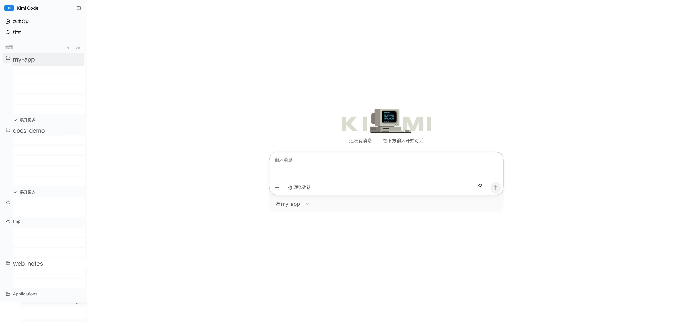
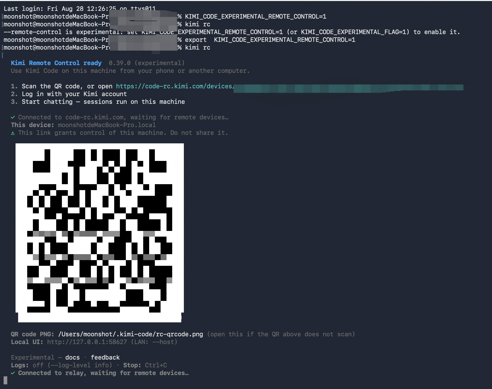

# Using in the Browser

Kimi Code Web is the browser-based graphical interface built into Kimi Code CLI: open it locally or on your LAN with `kimi web`, or turn on **Remote Control** (`kimi rc`) to scan a QR code and follow up from a phone, tablet, or another computer over the internet — all tasks and files stay and execute on your machine while the browser acts as a window.



## Local and LAN access

<div class="step">
<span class="step-num">1</span> <strong>Install Kimi Code CLI and log in</strong>

`kimi web` is a built-in CLI command. See [Getting Started](./getting-started.md) for installation and login.
</div>

<div class="step">
<span class="step-num">2</span> <strong>Run <code>kimi web</code> in a terminal</strong>

If you're already in the CLI, you can also type `/web` to hand the current session off to the browser.
</div>

<div class="step">
<span class="step-num">3</span> <strong>The web UI opens in your default browser once ready</strong>

The startup banner prints the access URL — if the browser doesn't open automatically, copy this URL and open it manually:

```text
Local:   http://127.0.0.1:58627/#token=...
Token:   ...
Stop:    Ctrl+C
```

::: warning
The `#token=` fragment is the access credential — don't share it. Stop the server with `Ctrl+C` in the terminal.
:::
</div>

### Startup options

| Option | Description |
| --- | --- |
| `--port <port>` | Bind port; defaults to `58627`, auto-increments when taken |
| `--host [host]` | Enable LAN sharing so phones, tablets, or other computers on the same network can connect; or specify an IP such as `--host 192.168.1.10` |
| `--no-open` | Don't open the browser when ready |
| `--log-level <level>` | Enable server logs at the given level; off by default |

## Remote Control (phone & public internet access) {#remote-control}

To check task progress, approve permissions, or continue chatting from your phone while away from your desk — without configuring port forwarding or a VPN — enable Remote Control (requires a logged-in paid Kimi membership and keeping your machine awake and online).

### Starting and connecting

Run any of the following foreground commands on your machine (one Remote Control instance per machine; up to about **3 devices** per account):

- **`kimi rc`** (alias `kimi remote`): start Remote Control directly;
- **`kimi web --remote-control`**: equivalent to `kimi rc`;
- **`/remote-control`** (alias `/rc`): hand your active CLI session directly to the remote web UI.

The terminal prints the access link (`https://code-rc.kimi.com/devices/<device ID>/` or `https://code-rc.kimi.ai/devices/<device ID>/` on global), a QR code (also saved as a PNG file), and your device hostname:



1. Open the access URL in a system browser on your phone or another computer (scan the QR code directly on mobile; if scanning inside WeChat, tap the top-right menu and choose "Open in Browser").
2. Log in with the **same** Kimi account as on your machine and select the device to view and control its sessions.

::: warning
The Remote Control link grants access to your machine upon signing into the same Kimi account — do not share it publicly. Press `Ctrl+C` in the local terminal to go offline (or run `kill <pid>` using the `pid` in `~/.kimi-code/server/rc.json` if you lost the terminal). Closing the remote browser tab leaves local tasks running uninterrupted.
:::

## Relationship with the CLI

The web UI and the CLI share the same login state, configuration (`config.toml`), and session data.

### Common slash commands

| Slash command | Description |
| --- | --- |
| `/new` | Start a new session |
| `/goal` | Enter Goal mode and keep working toward the same objective across turns |
| `/compact` | Compact the current session's context |
| `/tower` | [Tower multi-agent collaboration](./tower.md) (experimental); `/tower <base-branch>` sets the base branch without sending an objective |
| `/export` | Export the session content and troubleshooting logs as a ZIP |
| `/remote-control` | Enable Remote Control to access the local web session remotely |

Other CLI commands have point-and-click equivalents in the UI (settings, model picker, account menu, task panel):

<div class="feature-compare-table">

| Feature | CLI | Web | Notes |
| --- | --- | --- | --- |
| Streaming chat | ✓ | ✓ | Web renders rich formats incrementally (tables, code highlighting, diffs, tool cards) |
| Session management | ✓ | ✓ | Archive less-used sessions and restore them anytime; enable Open / Done / Workspaces tabs on the Lab settings page |
| Approvals | ✓ | ✓ | Click to approve or reject directly in the UI |
| Background tasks | ✓ | ✓ | Live progress in the task panel |
| Files and changes | ✓ | ✓ | Changed-files summary card and per-file diffs |
| Settings | ✓ | ✓ | Graphical settings UI (providers, account & usage, Lab experiments) |
| Global search | — | ✓ | Set `[database] global_search = true` in `config.toml` first to search across sessions and workspaces |
| Mobile layout | — | ✓ | Works in mobile browsers over LAN (`--host`) or Remote Control (`kimi rc`) |

</div>

## Security notes

- **Set a parallel credential on LAN**: when binding a LAN address (`--host`), also set the `KIMI_CODE_PASSWORD` environment variable so the server rate-limits failed authentication attempts.
- **Don't disable authentication entirely**: `--dangerous-bypass-auth` turns off all authentication — anyone who can reach the port can control your sessions, file system, and shell. Only use it on trusted networks or behind your own authenticating proxy (see the [kimi command reference](../reference/kimi-command.md#kimi-web)).

## FAQ

### Port already taken or invalid token?

When the default port is busy, `kimi web` automatically retries on the next port (58628, 58629, …) — use the URL printed in the banner. To rotate an invalid token, run `kimi web rotate-token`; running instances pick up the new token automatically without restarting.

### Troubleshooting LAN or Remote Control connections

- **LAN (`--host`)**: copy the full LAN URL including `#token=...`, verify your firewall allows the port, and confirm both devices are on the same subnet (guest Wi-Fi, VPNs, and phone hotspots isolate devices).
- **Remote Control (`kimi rc`)**: confirm the machine hasn't gone to sleep, the local `kimi rc` process is still running, and you are signed into the same paid Kimi account; if blocked inside WeChat's webview, open the link in Safari or Chrome instead.

## Next steps

- [Using in Scripts and CI](./print.md) — one-shot non-interactive runs and structured JSONL output
- [Using in Other Agents](./other-agents.md) — drive and hand off sessions from Claude Code, Codex, and Cursor
- [kimi command](../reference/kimi-command.md#kimi-web) — all `kimi web` and `kimi rc` options
