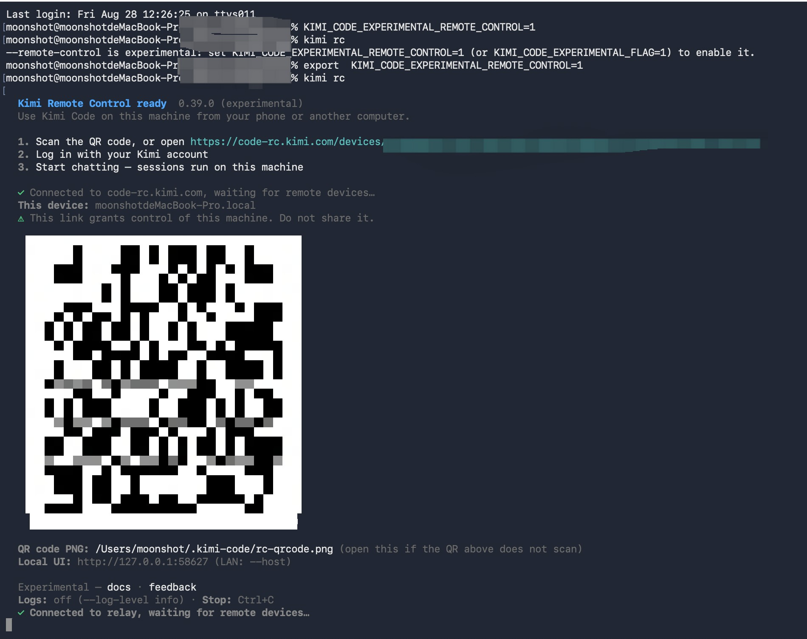

# Controle remoto

Inicie a Kimi Code CLI com o controle remoto ativado executando `kimi rc` em um terminal — isso gera um link que permite controlar esta máquina remotamente. Escaneie o código QR com seu celular para abrir o link ou acesse-o diretamente em outro dispositivo. Após abrir o link, faça login com a mesma conta Kimi utilizada na sua Kimi Code CLI local para acompanhar o progresso de tarefas, gerenciar aprovações, continuar conversas ou iniciar novas sessões. As tarefas são sempre executadas na sua máquina — a página web funciona apenas como uma janela remota.

## Primeiros passos

### Pré-requisitos

Antes de ativar o Controle Remoto (Remote Control), certifique-se de que sua máquina atenda às seguintes condições:

- **Kimi Code CLI instalado**: consulte [Primeiros passos](../guides/getting-started.md)
- **Conta Kimi com assinatura paga**: o Controle Remoto exige uma assinatura paga e não está disponível para usuários da versão gratuita
- **Máquina ativa e conectada à rede**: o Controle Remoto depende de uma conexão persistente entre sua máquina e o serviço Kimi; as sessões remotas não ficam disponíveis caso a máquina seja desligada, entre em modo de suspensão ou perca a conexão com a rede

### Passo 1: Iniciar o Controle Remoto

Inicie-o em sua máquina de uma das seguintes formas — todas são equivalentes: cada uma inicia um processo em primeiro plano e exibe as informações de acesso remoto.

- **`kimi rc`** (ou `kimi remote`): inicia o Controle Remoto diretamente
- **`kimi web --remote-control`**: equivalente a `kimi rc` — inicia a interface web local e, simultaneamente, a expõe à internet pública
- **`/remote-control`** (ou `/rc`): utilize durante uma sessão na CLI para transferir a sessão atual para a interface remota

Após a inicialização, o terminal exibirá a URL de acesso (como `https://code-rc.kimi.com/devices/<ID do dispositivo>/` para logins na China continental, ou `https://code-rc.kimi.ai/devices/<ID do dispositivo>/` caso tenha utilizado `kimi login --region global`), um código QR e o nome do dispositivo (o *hostname* da máquina). O navegador padrão abrirá a URL automaticamente (use `--no-open` para evitar que isso ocorra). Além da exibição no terminal, o código QR também é salvo como um arquivo PNG (o caminho é indicado na saída da inicialização) — caso o código QR não seja exibido corretamente no seu terminal, abra esse arquivo.

::: warning Aviso
O link de Controle Remoto (Remote Control) serve como um ponto de acesso para controlar esta máquina — qualquer pessoa que tenha acesso a ele poderá controlar suas sessões e arquivos. Não o compartilhe com terceiros nem o publique em locais públicos.
:::

Duas limitações:

- Apenas uma instância de Controle Remoto pode ser executada por máquina. Se você tentar iniciá-la novamente, o sistema informará a existência de uma instância ativa e exibirá o link que já está em uso — consulte [Como desativar o Controle Remoto](#how-to-turn-off-remote-control) para saber como encerrar a instância anterior.
- O Controle Remoto não pode ser utilizado em conjunto com a opção `--dangerous-bypass-auth` e vincula-se apenas ao endereço de *loopback* (o compartilhamento via rede local/LAN por meio do parâmetro `--host` não é suportado — o acesso remoto ocorre por meio do serviço de *relay* do Kimi).

### Passo 2: Conecte-se a partir de outro dispositivo

1. Abra a URL de acesso — exibida na saída do terminal durante a inicialização — em um navegador no seu celular ou em outro computador. Se estiver usando um celular, você também pode escanear diretamente o código QR que aparece no terminal.
2. Faça login com a mesma conta Kimi utilizada na máquina.
3. Após o login, selecione esta máquina na lista de dispositivos (identificada pelo seu nome de host) para visualizar suas sessões e começar a trabalhar.

O Controle Remoto funciona diretamente no navegador.

::: info Limite de dispositivos
Atualmente, cada conta suporta até cerca de **3 dispositivos**.
:::

### Como desativar o Controle Remoto

O Controle Remoto é um processo em primeiro plano; a forma de interrompê-lo depende se você consegue localizar o terminal que o iniciou:

- **O terminal ainda está aberto**: pressione `Ctrl+C` nesse terminal (ou simplesmente feche a janela) — o dispositivo ficará imediatamente offline na lista de dispositivos remotos.
- **Não consegue encontrar o terminal**: o arquivo de bloqueio de instância única `~/.kimi-code/server/rc.json` registra o PID (ID do processo) e o link em uso (o erro exibido ao tentar iniciar uma segunda instância também apresenta essas informações) — execute `kill <pid>`.
- **O processo já foi encerrado** (queda de energia, falha, etc.): o arquivo de bloqueio residual é removido automaticamente na próxima inicialização — não é necessário excluí-lo manualmente.

Para iniciar uma nova instância, encerre a anterior seguindo um dos métodos acima e execute `kimi rc` novamente — não existe um comando específico para reinicialização. O ID do dispositivo é gerado com base no diretório de dados da máquina; portanto, o dispositivo e sua URL de acesso permanecem os mesmos. A interface web para gerenciamento e revogação de dispositivos estará disponível na versão final.

## O que você pode fazer em uma sessão remota

As sessões remotas oferecem, essencialmente, as mesmas funcionalidades das sessões locais:

- **Enviar novas tarefas**: descreva o que você precisa; a tarefa será executada em sua máquina.
- **Acompanhar o progresso**: as etapas de execução e as ferramentas utilizadas são exibidas em tempo real.
- **Continuar a conversa**: dê continuidade a sessões já existentes.
- **Inspecionar chamadas de ferramentas**: visualize os detalhes de entrada e saída de cada execução de ferramenta.
- **Gerenciar aprovações**: aprove ou recuse edições de arquivos, comandos de Shell e outras solicitações de confirmação diretamente pela página web.
- **Interromper ou parar tarefas**: encerre a tarefa em execução a qualquer momento.
- **Verificar o status de subagentes/fluxos de trabalho**: monitore subagentes ou fluxos de trabalho acionados pela tarefa por meio do painel de tarefas.

## O que acontece na sua máquina

O Controle Remoto (Remote Control) é apenas uma janela remota — todo o processamento e as operações de arquivo continuam ocorrendo na sua máquina. Veja os detalhes:

| Conteúdo | Ocorre localmente |
| --- | --- |
| Leitura de arquivos do projeto | Sim |
| Modificação de arquivos do projeto | Sim |
| Execução de comandos no terminal (Shell) | Sim |
| Uso de MCP local | Sim |
| Interface (UI) no celular ou navegador | Não |
| Sincronização da sessão | Via serviço Kimi |

## Desconexões, modo de suspensão e recuperação

- **Fechar o navegador**: a tarefa continua sendo executada na sua máquina. Basta abrir novamente a URL de acesso para recuperar a visualização da sessão.
- **Perda de conexão de rede**: quando offline, a interface remota é desconectada e torna-se inutilizável. O processo de Controle Remoto e o servidor local continuam rodando, mas uma tarefa em andamento pode travar ou falhar, já que as solicitações ao modelo não conseguem ser enviadas. Assim que a rede for restabelecida, a máquina reconecta-se automaticamente ao relay — basta atualizar a página remota; não é necessário reiniciar.
- **Suspensão (modo de repouso) da máquina**: a conexão de Controle Remoto é encerrada, e as tarefas podem ser pausadas ou falhar. Configure o computador para nunca entrar em modo de suspensão (nas configurações do sistema) ou mantenha-o ativo durante o uso.
- **Encerramento do processo local**: pressionar `Ctrl+C` ou fechar o terminal interrompe o Controle Remoto e remove o dispositivo da lista de dispositivos remotos. Reinicie o processo para restabelecer a conexão.
- **Encerrar a conexão remota mantendo a tarefa local**: basta fechar a página web — a tarefa local não será afetada.

## Qual é a diferença entre o Remote Control e o Kimi Code Web?

O [Kimi Code Web](../guides/web.md) é a interface gráfica disponível na sua máquina ou rede local (LAN); o Remote Control estende essa funcionalidade para qualquer dispositivo conectado à internet pública:

| | Kimi Code Web | Remote Control |
| --- | --- | --- |
| Escopo de acesso | `localhost` ou rede local (LAN) usando `--host` | Qualquer dispositivo na internet pública (via relay do Kimi) |
| Como iniciar | Execute `kimi web` no terminal | `kimi rc`, `kimi web --remote-control` ou `/remote-control` na CLI |
| Autenticação | Token local | Login com a mesma conta Kimi |
| Onde os dados e a execução residem | Na sua máquina | Na sua máquina (a página web é apenas uma janela remota) |
| Cenário típico | Interface gráfica (GUI) em um navegador local | Acompanhamento remoto via celular, tablet ou outro computador |

Para conhecer os recursos da interface web, consulte [Usando o Kimi Code no navegador](../guides/web.md).

## Segurança e permissões

### Como dispositivos remotos realizam a autenticação

Para visualizar e controlar sessões, um dispositivo remoto deve fazer login utilizando a mesma conta Kimi vinculada à máquina. Seus dispositivos nunca ficam expostos a outras contas, e não existe nenhum link público que funcione sem a realização de login.

### A URL de acesso contém informações sensíveis?

A URL de acesso, por si só, não contém dados de sessão nem tokens locais; todas as informações são exibidas com base nas permissões da conta após o login. No entanto, como ela serve como um ponto de entrada para o controle remoto desta máquina, o aviso exibido durante a inicialização recomenda que você não a compartilhe.

## Perguntas frequentes (FAQ)

### O link não abre dentro do WeChat — o que devo fazer?

O navegador integrado do WeChat restringe o acesso a algumas páginas externas devido às suas políticas de segurança. Por isso, ao tentar abrir a URL de acesso ao controle remoto (`https://code-rc.kimi.com/…`) diretamente no WeChat, é possível que você se depare com um aviso de "acesso à página da web interrompido".

Como resolver: toque no menu "…" (três pontos) no canto superior direito e selecione a opção para abrir a página no seu navegador padrão, ou copie o link e cole-o em um navegador do sistema, como o Safari ou o Chrome. O mesmo procedimento deve ser seguido ao utilizar o leitor do WeChat para escanear o código QR de inicialização: abra o link em um navegador para garantir o acesso a todas as funcionalidades da sessão.

### A tarefa é interrompida quando fecho o navegador?

Não. O navegador é apenas uma janela — a tarefa é executada na sua máquina. Fechar a página não a interrompe; basta abrir o link novamente para retomar a visualização.

### Posso continuar após fechar o terminal local?

Não. O Controle Remoto (Remote Control) depende que o processo correspondente permaneça ativo na sua máquina; se esse processo for encerrado, a conexão remota é interrompida. Reinicie-o para restabelecer a conexão.

### É possível acessar arquivos locais diretamente pelo celular?

Não. O celular não possui um canal direto com o sistema de arquivos da sua máquina: o que você vê no celular é o conteúdo renderizado dentro da interface da sessão (como diferenças em arquivos ou cartões de arquivo após edições feitas pela IA), enquanto todas as operações de leitura/escrita de arquivos e execução de comandos ocorrem na máquina. O celular não consegue navegar, abrir ou baixar arquivos locais fora de uma sessão.

### Como solucionar falhas na conexão remota

Verifique os seguintes pontos, nesta ordem:

1. **Estado da máquina**: certifique-se de que a máquina está ativa e não entrou em modo de suspensão.
2. **Conectividade de rede**: verifique se a máquina tem acesso à internet.
3. **Status do processo**: confirme se o processo de Controle Remoto está em execução na máquina.
4. **Conta utilizada**: verifique se a interface web está conectada com a mesma conta Kimi.
5. **Firewall e proxy**: verifique se a sua rede corporativa ou proxy está bloqueando o endereço `code-rc.kimi.com`.

## Próximos passos

- [Usando o Kimi Code no navegador](../guides/web.md) — O Controle Remoto utiliza a mesma interface web; saiba mais sobre as funcionalidades dessa interface.