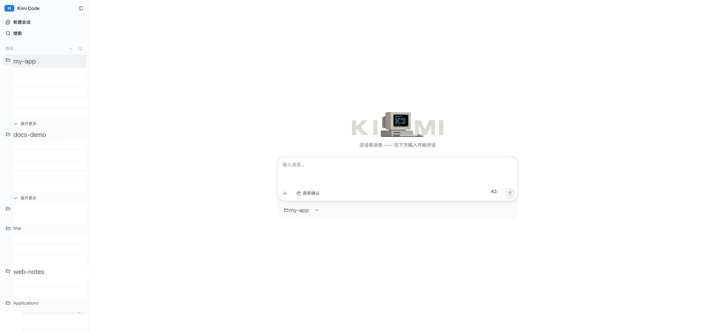

# Usando o Kimi Code no navegador

O Kimi Code Web é a interface gráfica baseada em navegador, integrada ao Kimi Code CLI: execute `kimi web` em um terminal para iniciar sessões, conversar, gerenciar aprovações e revisar alterações em arquivos — tudo por meio de uma interface mais amigável, mantendo as sessões e os dados armazenados inteiramente em sua própria máquina.



## Primeiros passos

<div class="step">
<span class="step-num">1</span> <strong>Instale o Kimi Code CLI e faça login</strong>

O comando `kimi web` faz parte do CLI — ele não está disponível sem a instalação do CLI. Consulte a seção [Primeiros passos](./getting-started.md) para obter instruções sobre instalação e login.
</div>

<div class="step">
<span class="step-num">2</span> <strong>Execute <code>kimi web</code> em um terminal</strong>

Se você já estiver utilizando o CLI, também pode digitar `/web` para transferir a sessão atual para o navegador.
</div>

<div class="step">
<span class="step-num">3</span> <strong>A interface web abrirá no seu navegador padrão assim que estiver pronta</strong>

O banner de inicialização exibirá a URL de acesso — caso o navegador não abra automaticamente, copie essa URL e abra-a manualmente:

```text
Local:   http://127.0.0.1:58627/#token=...
Token:   ...
Parar:   Ctrl+C
```

::: warning
O fragmento `#token=` é a credencial de acesso — não o compartilhe. Interrompa o servidor usando `Ctrl+C` no terminal.
:::
</div>

### Opções de inicialização

| Opção | Descrição |
| --- | --- |
| `--port <porta>` | Define a porta; o padrão é `58627`, sendo incrementada automaticamente caso já esteja em uso |
| `--host [host]` | Permite que celulares, tablets ou outros computadores na mesma rede local (LAN) acessem o endereço web; você também pode especificar um IP, por exemplo: `--host 192.168.1.10` |
| `--no-open` | Não abre o navegador automaticamente ao iniciar |
| `--log-level <nível>` | Habilita logs do servidor no nível especificado; desativado por padrão |

### Comandos comuns (iniciados por barra)

| Comando | Descrição |
| --- | --- |
| `/new` | Inicia uma nova sessão |
| `/goal` | Entra no modo "Meta" (Goal), mantendo o foco no mesmo objetivo ao longo das interações |
| `/compact` | Compacta o contexto da sessão atual |
| `/tower` | Colaboração multiagente "Tower" (experimental); `/tower <branch-base>` define a branch (ramificação) base |
| `/export` | Exporta o conteúdo da sessão e os logs de diagnóstico em um arquivo ZIP |
| `/remote-control` | Habilita o controle remoto para acessar a sessão web local a partir de outro dispositivo |

## Relação com a CLI

A interface web (web UI) e a CLI compartilham o mesmo estado de login, configuração (`config.toml`) e dados de sessão.

A interface web oferece suporte apenas a um subconjunto dos comandos (slash commands) da CLI — veja [Comandos comuns (slash commands)](#common-slash-commands) acima. Todo o restante geralmente possui um equivalente de "apontar e clicar" na interface (a página de configurações, o seletor de modelos, o menu da conta, o painel de tarefas).

Comparação entre as duas interfaces:

<div class="feature-compare-table">

| Funcionalidade | CLI | Web | Observações |
| --- | --- | --- | --- |
| Chat em tempo real (streaming) | ✓ | ✓ | A interface web renderiza formatos complexos de forma incremental (tabelas, destaque de código, diferenças/diffs, cartões de ferramentas) |
| Gerenciamento de sessões | ✓ | ✓ | A interface web permite arquivar sessões pouco utilizadas; a página de arquivo as organiza por data e você pode restaurá-las a qualquer momento; as abas "Open" (Abertas), "Done" (Concluídas) e "Workspaces" (Espaços de trabalho) fazem parte de um experimento (desativadas por padrão) — ative-as na página "Lab" dentro das configurações |
| Aprovações | ✓ | ✓ | Na interface web, são realizadas por meio de cliques — sem necessidade de comandos |
| Tarefas em segundo plano | ✓ | ✓ | A interface web exibe o progresso em tempo real no painel de tarefas |
| Arquivos e alterações | ✓ | ✓ | A interface web inclui um cartão de resumo de arquivos alterados e visualização de diferenças (diffs) por arquivo |
| Configurações | ✓ | ✓ | A interface web conta com uma tela dedicada para configurações (provedores, conta e uso, experimentos/Lab) |
| Busca global | — | ✓ | A interface web permite pesquisar em todas as sessões e espaços de trabalho |
| Layout para dispositivos móveis | — | ✓ | Com o compartilhamento via rede local (LAN) ativado (`--host`), funciona em navegadores de celulares conectados à mesma rede |

</div>

## Observações de segurança

- **Defina uma credencial adicional**: ao vincular a um endereço de rede local (LAN), configure também a variável de ambiente `KIMI_CODE_PASSWORD`; o servidor passará a limitar automaticamente a taxa de tentativas de autenticação malsucedidas.
- **Não desative a autenticação por completo**: a opção `--dangerous-bypass-auth` desativa toda a autenticação — qualquer pessoa que consiga acessar a porta poderá controlar suas sessões, seu sistema de arquivos e seu shell. Utilize esse recurso apenas em redes confiáveis ​​ou atrás de um proxy que realize a autenticação. Consulte a referência de comandos do `kimi` em [kimi-command.md](../reference/kimi-command.md#kimi-web).

## Perguntas frequentes (FAQ)

### A porta já está em uso

Não é necessário fazer nada. O `kimi web` tenta automaticamente utilizar a próxima porta disponível (58628, 58629, …) — basta usar o endereço exibido na mensagem de inicialização.

### A URL não abre no navegador

Primeiro, verifique se o servidor ainda está em execução no terminal (ele roda em primeiro plano). Copie a URL completa, incluindo a parte `#token=`; ao acessar apenas `http://127.0.0.1:58627`, você será direcionado a uma página para inserir o token — basta colar ali o valor do `Token` que aparece na mensagem de inicialização.

### Como recuperar-se de um token inválido

Execute `kimi web rotate-token` para gerar um novo token e, em seguida, abra a nova URL exibida. Todas as instâncias em execução passarão a utilizar o novo token automaticamente — não é necessário reiniciar.

### Outros dispositivos na mesma rede Wi-Fi não conseguem se conectar

Certifique-se de ter iniciado o processo com a flag `--host` (o uso isolado, sem argumentos adicionais, é suficiente) e utilize a URL de rede local (LAN) exibida (por exemplo: `http://192.168.x.x:58627/#token=...`). Se a conexão ainda falhar, verifique se o firewall da máquina permite o tráfego na porta utilizada e se ambos os dispositivos estão, de fato, no mesmo segmento de rede — redes Wi-Fi para visitantes, VPNs e o uso de um ponto de acesso (hotspot) 4G/5G isolam os dispositivos entre si.

## Próximos passos

- [API do Servidor (Server API)](../reference/server-api.md) — APIs REST / WebSocket para scripts e integrações de terceiros (experimental)
- [Comando `kimi`](../reference/kimi-command.md#kimi-web) — todas as opções de linha de comando para `kimi web`
- [Controle Remoto](./remote-control.md) — visualize e assuma o controle de sessões locais remotamente, a partir de qualquer dispositivo e via internet pública