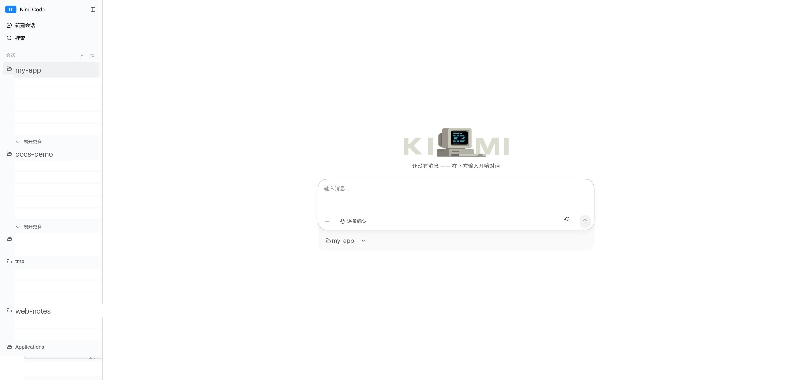
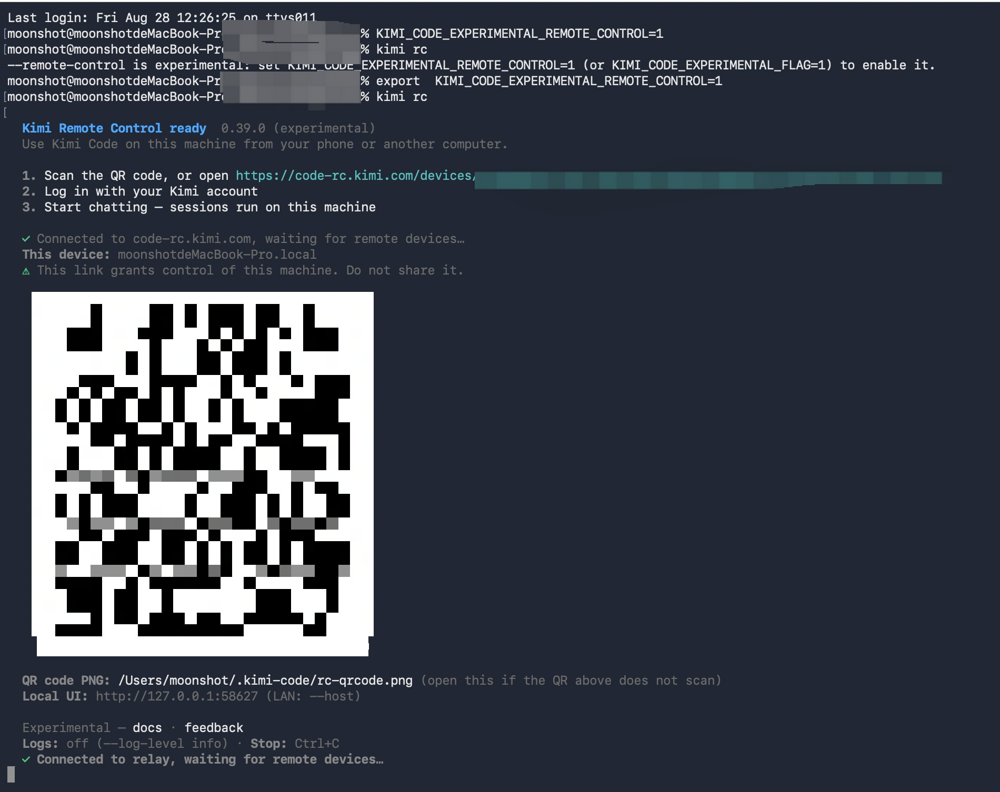

# 在网页中使用

Kimi Code Web 是 Kimi Code CLI 内置的浏览器图形界面：既可以在本机或局域网浏览器里直接运行 `kimi web` 使用，也可以开启**远程控制**（`kimi rc`）从公网上的手机、平板或另一台电脑扫码访问——任务和数据始终全部运行并保存在你的本机，网页只是交互窗口。



## 本机与局域网使用

<div class="step">
<span class="step-num">1</span> <strong>安装并登录 Kimi Code CLI</strong>

`kimi web` 是 CLI 的内置命令，未安装 CLI 时不可用。安装与登录见 [开始使用](./getting-started.md)。
</div>

<div class="step">
<span class="step-num">2</span> <strong>在终端运行 <code>kimi web</code></strong>

如果你已经在 CLI 里，也可以输入 `/web`，把当前会话交接到浏览器。
</div>

<div class="step">
<span class="step-num">3</span> <strong>服务就绪后自动用默认浏览器打开 Web 界面</strong>

启动横幅会打印访问地址，浏览器没有自动打开时，手动复制这行地址打开即可：

```text
Local:   http://127.0.0.1:58627/#token=...
Token:   ...
Stop:    Ctrl+C
```

::: warning 注意
地址里的 `#token=` 是访问凭证，请勿外发，停止服务在终端按 `Ctrl+C`。
:::
</div>

### 启动选项

| 选项 | 说明 |
| --- | --- |
| `--port <port>` | 绑定端口；默认 `58627`，被占用时自动 +1 重试 |
| `--host [host]` | 开启局域网共享，让同一网络下的手机、平板或其他电脑访问；也可指定 IP，如 `--host 192.168.1.10` |
| `--no-open` | 就绪后不自动打开浏览器 |
| `--log-level <level>` | 按所选级别开启服务日志；默认不输出 |

## 远程控制（公网与手机访问） {#远程控制}

当你想在外出时用手机跟进任务进度、批复权限或继续对话，无需配置局域网或内网穿透，直接开启远程控制即可（需已登录 Kimi 账号且具备付费会员权限，本机保持唤醒联网）。

### 启动与连接

在本机任选一种方式启动前台进程（一台机器同时只能运行一个远程控制实例，每个账号最多支持约 **3 台**设备）：

- **`kimi rc`**（别名 `kimi remote`）：直接启动远程控制；
- **`kimi web --remote-control`**：与 `kimi rc` 等价；
- **`/remote-control`**（别名 `/rc`）：已在 CLI 会话中时，把当前会话直接交给远程界面。

启动后终端会打印访问链接（国内 `https://code-rc.kimi.com/devices/<设备 ID>/`，全球区 `https://code-rc.kimi.ai/devices/<设备 ID>/`）、二维码（同时另存为 PNG 文件）与设备名：



1. 在手机或另一台电脑的系统浏览器中打开访问链接（手机可直接扫码；微信扫一扫后请点右上角「在浏览器中打开」）。
2. 登录与本机**相同**的 Kimi 账号，在设备列表中选择这台机器即可查看并操控会话。

::: warning 注意
远程控制链接对应这台机器的访问入口，仅限登录同一 Kimi 账号后使用，请勿分享给他人。结束时在本地终端按 `Ctrl+C` 即可下线（若找不到原终端，可根据 `~/.kimi-code/server/rc.json` 中的 `pid` 执行 `kill <pid>`）。关闭远程浏览器页面不会中断本机正在运行的任务。
:::

## 与 CLI 的关系

Web 界面和 CLI 共享同一份登录态、配置（`config.toml`）和会话数据。在 macOS 与 Linux 上，`kimi web`、`kimi rc` 与连接到同一台机器的桌面端 SSH 环境默认复用同一个本机后台服务，因此正在运行的会话、流式输出和审批状态也会实时同步（需要完全隔离时可加 `--no-daemon`）。

### 常用斜杠命令

| 斜杠命令 | 说明 |
| --- | --- |
| `/new` | 新开会话 |
| `/goal` | 进入目标模式，跨轮次持续推进同一目标 |
| `/compact` | 压缩当前会话上下文 |
| `/tower` | [Tower 多 Agent 协作](./tower.md)（实验功能）；`/tower <base-branch>` 指定基准分支，但不发送任务目标 |
| `/export` | 导出会话内容与故障排查日志为 ZIP |
| `/remote-control` | 开启远程控制，从公网远程访问本地 Web 会话 |

其余 CLI 指令在 Web 里有对应的图形入口（设置页、模型选择器、账户菜单、任务面板）。两端能力对照如下：

<div class="feature-compare-table">

| 功能 | CLI | Web | 说明 |
| --- | --- | --- | --- |
| 流式对话 | ✓ | ✓ | Web 为富格式增量渲染（表格、代码高亮、diff、工具卡片） |
| 会话管理 | ✓ | ✓ | Web 可把不常用的会话归档收起，按时间排序并随时恢复；Open / Done / Workspaces 标签页可在设置的 Lab 页开启 |
| 审批处理 | ✓ | ✓ | Web 可在图形页面中点击处理，无需指令 |
| 后台任务 | ✓ | ✓ | Web 为任务面板实时展示进度 |
| 文件与改动 | ✓ | ✓ | Web 有改动文件摘要卡与逐文件 diff |
| 设置 | ✓ | ✓ | Web 另有图形化设置页（供应商、账号与用量、Lab 实验特性） |
| 全局搜索 | — | ✓ | 需先在 `config.toml` 中设置 `[database] global_search = true`，之后可跨会话、跨工作区搜索 |
| 移动端适配 | — | ✓ | 通过 `--host` 局域网共享或 `kimi rc` 远程控制，均可在手机浏览器中使用 |

</div>

## 安全注意

- **局域网绑定建议设置密码**：使用 `--host` 绑定局域网地址时，建议额外设置 `KIMI_CODE_PASSWORD` 环境变量，服务端会对鉴权失败自动限流。
- **不要彻底关闭鉴权**：`--dangerous-bypass-auth` 会关闭所有鉴权，任何能访问该端口的人都能控制你的会话、文件系统和 shell。仅在可信网络或自有鉴权代理之后使用，详见 [kimi 命令参考](../reference/kimi-command.md#kimi-web)。

## 常见问题

### 端口被占用或 token 失效了怎么办？

端口占用无需处理，`kimi web` 会自动用下一个端口重试（58628、58629……），以横幅打印的地址为准。token 失效时运行 `kimi web rotate-token` 生成新 token，运行中的实例会自动换用新 token，无需重启。

### 局域网其他设备或远程控制连不上怎么排查？

- **局域网（`--host`）**：确认使用横幅里的局域网 IP 地址（含 `#token=...`），检查本机防火墙是否放行端口，并确认两台设备不在访客 WiFi、VPN 或手机热点隔离网段。
- **远程控制（`kimi rc`）**：确认本机未休眠（休眠会断开中转连接，建议开启期间保持唤醒）、本地终端进程仍在运行、网页登录的是同一个付费会员账号；在微信内打开链接被拦截时，点右上角菜单选择在系统浏览器中打开。

## 下一步

- [print 模式](../reference/kimi-command.md#print-模式) — 单次执行、结构化输出与退出码
- [在其他 Agent 中使用（Agent to Agent）](./other-agents.md) — 从 Claude Code、Codex、Cursor 等 Agent 驱动与交接会话
- [kimi 命令](../reference/kimi-command.md#kimi-web) — `kimi web` 与 `kimi rc` 的全部命令行选项
